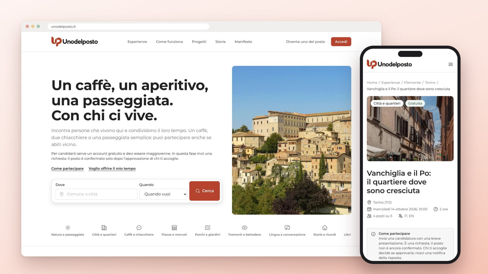
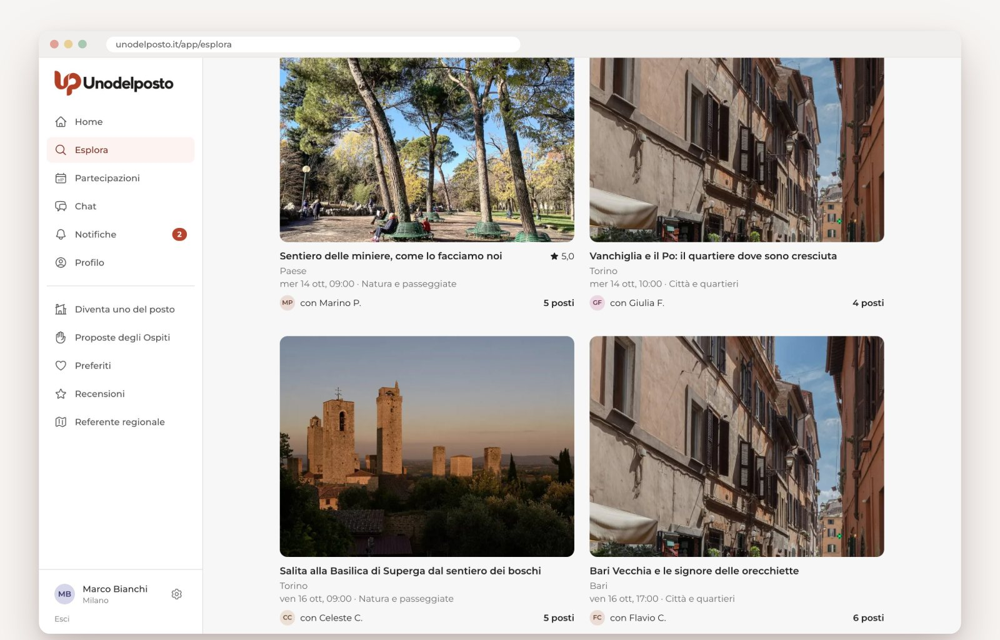
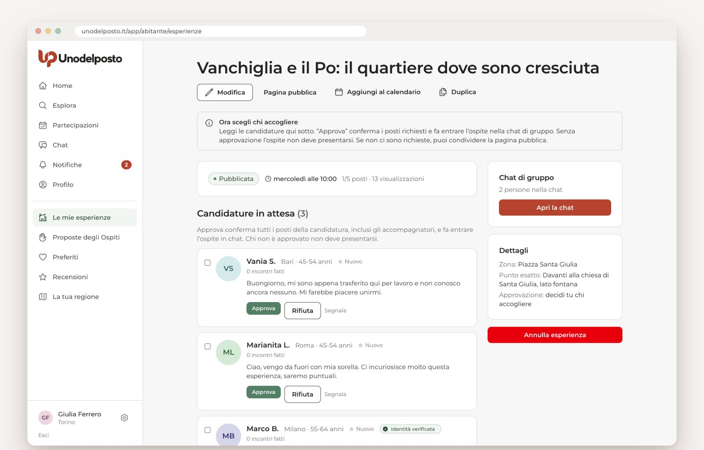
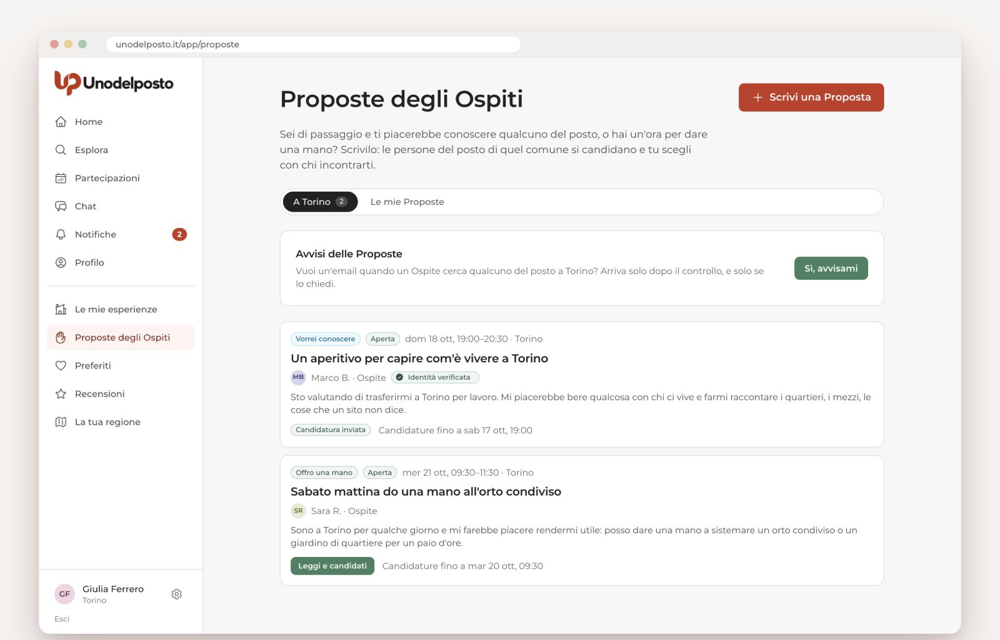
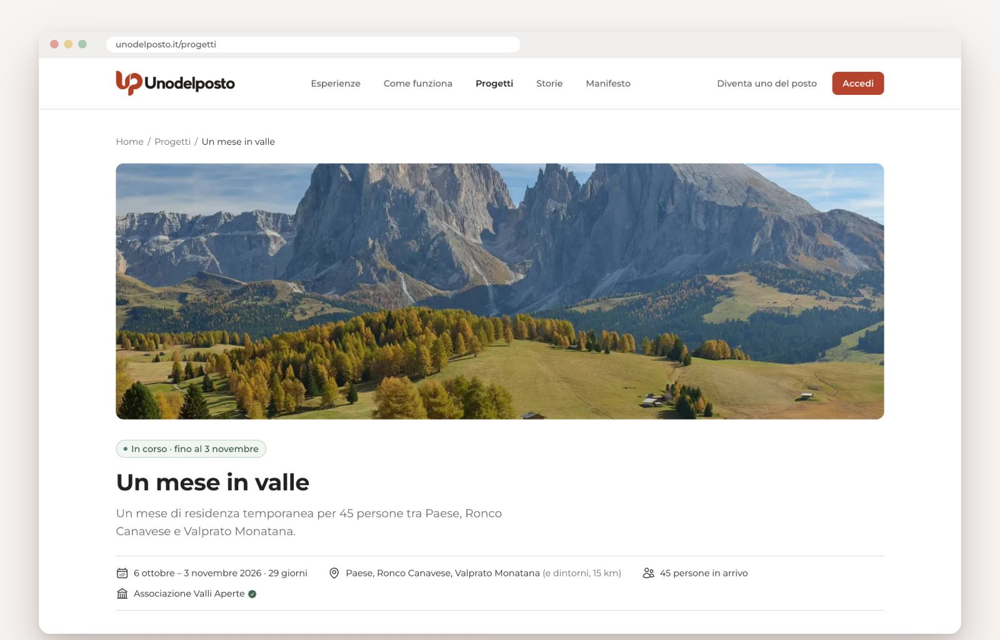
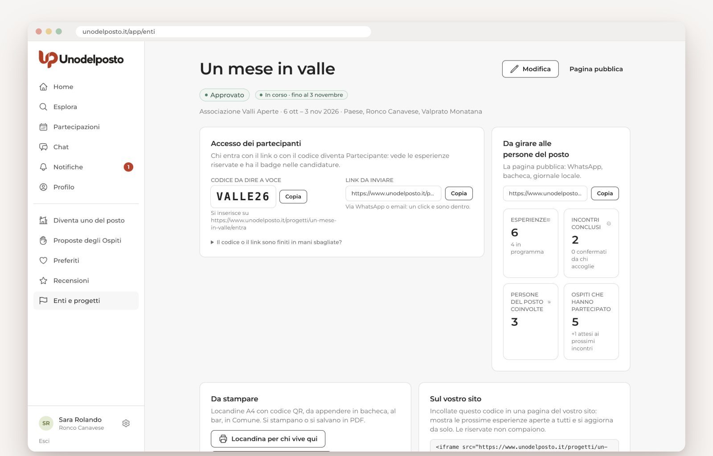
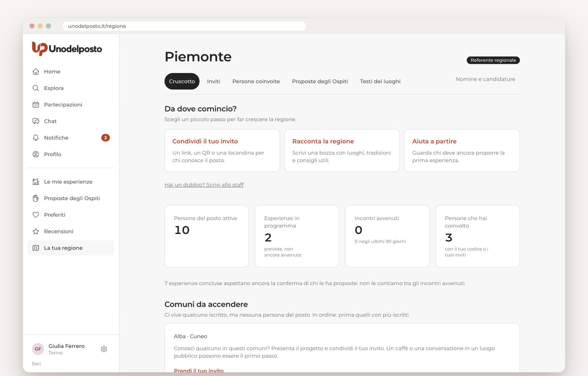
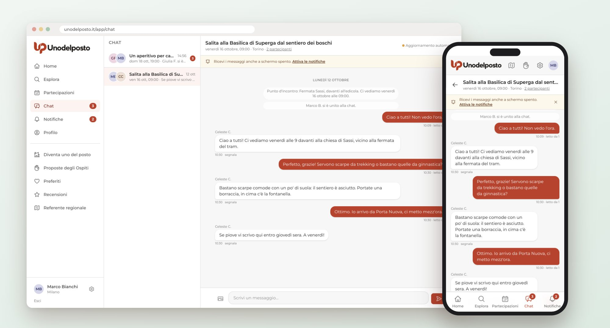

# Unodelposto — Community

> Un caffè, un aperitivo, una passeggiata. Con chi ci vive.

**Unodelposto** è una piattaforma gratuita dove chi è del posto regala qualche ora del proprio tempo per far conoscere il suo luogo a chi viene da fuori. Nessun pagamento, mai. Il digitale serve solo a far incontrare le persone dal vivo.

🌐 Sito: [unodelposto.it](https://unodelposto.it) · 📘 [Guide online](https://OWNER.github.io/unodelposto-community/) · 📄 [Guide in PDF](docs/guide/README.md)

Questa repository ospita la presentazione, la documentazione e lo spazio di confronto sul progetto. **Non contiene il codice sorgente.**

---

## Come funziona

1. **Una persona del posto propone un'esperienza**: due chiacchiere al parco, un caffè in piazza, la passeggiata che fa dopo il lavoro.
2. **Gli Ospiti si candidano.** Chi propone sceglie chi partecipa.
3. **Nasce una chat di gruppo** con la persona del posto e gli Ospiti approvati. Il punto d'incontro preciso compare solo lì, e non serve scambiarsi il numero di telefono.
4. **Ci si incontra dal vivo.**
5. **Ci si recensisce a vicenda**, in entrambe le direzioni.

Funziona anche al contrario: con la **Proposta dell'Ospite** chi arriva scrive cosa vorrebbe fare («vorrei cenare con qualcuno del posto e capire come si vive qui») oppure che aiuto può offrire («sabato mattina posso dare una mano a spostare la legna»). Le persone del posto di quel comune rispondono, l'Ospite sceglie.

## Per chi è

| Chi | Cosa trova |
|-----|-----------|
| **Persone del posto** | Un modo semplice per conoscere persone nuove e raccontare il proprio luogo, senza venderlo. |
| **Ospiti** | Esperienze vere, con chi vive in un posto. Anche nel paese accanto. |
| **Enti** (associazioni, Comuni, Pro Loco, scuole) | Una pagina per i propri Progetti sul territorio, strumenti per coordinare le persone del posto e numeri da portare ai finanziatori. |

## I principi

- **Zero denaro.** Niente pagamenti, mance o "contributi spese", né sulla piattaforma né negli annunci.
- **Socialità reale.** Il prodotto spinge verso l'incontro, non verso il tempo passato davanti allo schermo.
- **Reciprocità.** Chi accoglie e chi partecipa hanno la stessa dignità e gli stessi strumenti.
- **Fiducia e sicurezza.** Profili, recensioni, segnalazioni, blocco, punto d'incontro rivelato solo agli approvati, moderazione dello staff.

## Il manifesto

> Il tempo regalato vale più del tempo venduto.

Il [manifesto](https://www.unodelposto.it/manifesto) spiega perché Unodelposto esiste, perché è gratis, come si sostiene e cosa non sarà mai. In breve:

- **Gratis per tutti, per sempre.** Non paga nessuno: né le persone del posto, né gli Ospiti, né le associazioni e i Comuni. Nessun abbonamento, nessuna quota, nessuna "versione pro".
- **Niente denaro tra le persone, in nessuna forma.** Niente prezzi, mance, "contributo spese" o offerta libera.
- **Come si sostiene.** Oggi con il tempo di chi ci lavora. In futuro potranno arrivare bandi e finanziamenti di fondazioni, rimborsi spese, qualche inserzione di realtà del territorio, eventi o merchandising. Nessuna di queste entrate cambierà le promesse qui sopra. La pubblicità, se ci sarà, verrà sempre dichiarata e non sarà mai basata sul profilo di chi la vede.
- **Cosa non sarà mai:** un marketplace, un tour operator, un'app di incontri, un posto dove la pubblicità si confonde con le persone.

## A chi appartiene Unodelposto

Oggi il progetto è intestato a [Ludosweb S.r.l.](https://www.ludosweb.com), la società che lo ha costruito. È una scelta di semplicità: una società che esiste già ha partita IVA, contratti e server, e permette di far funzionare il sito senza costituire un ente nuovo prima ancora di sapere se il progetto servirà a qualcuno.

Non è un progetto commerciale. Ludosweb si impegna, se Unodelposto prenderà piede, a cederlo gratuitamente a un'associazione senza scopo di lucro, che ne diventerà titolare e lo gestirà: marchio, dominio e, nel rispetto della privacy, i dati. Ludosweb resterà solo come partner tecnologico.

Per trasparenza: il codice sorgente della piattaforma è e resterà di proprietà di Ludosweb, che lo mette a disposizione del progetto gratuitamente, oggi e dopo la cessione.

Se succederà, lo scriveremo qui e nei Termini di servizio, dove trovi anche i dati di chi gestisce il servizio oggi. [Leggi i Termini](https://www.unodelposto.it/termini)

_Lo stesso testo è pubblicato nel [manifesto](https://www.unodelposto.it/manifesto)._

## Fase attuale: pilota

Il progetto è in una fase pilota prudente:

- poche categorie, tutte di socialità semplice in luoghi pubblici (passeggiate, caffè e chiacchiere, piazze e mercati, conversazione in lingua…);
- al massimo 6 Ospiti per incontro e 3 ore di durata;
- ogni esperienza viene letta dallo staff prima della pubblicazione;
- nessuna visita guidata e nessuna attività che richieda qualifiche.

## Screenshot

<table>
<tr>
<td width="50%"> <b>Esplora.</b> Le esperienze vicino a te, per comune, data e tipo di incontro, anche sulla mappa.</td>
<td width="50%"> <b>Chi accoglie decide.</b> La persona del posto legge le candidature e sceglie chi far partecipare.</td>
</tr>
<tr>
<td width="50%"> <b>Proposte degli Ospiti.</b> Chi arriva scrive cosa vorrebbe fare o che aiuto offre; rispondono le persone del posto.</td>
<td width="50%"> <b>Progetti territoriali.</b> Un Ente porta un gruppo in un territorio e le persone del posto propongono gli incontri.</td>
</tr>
<tr>
<td width="50%"> <b>Area dell'Ente.</b> Codice per i partecipanti, esperienze da approvare, numeri per la rendicontazione.</td>
<td width="50%"> <b>Referenti regionali.</b> Chi conosce il territorio aiuta a far partire Unodelposto nella sua regione.</td>
</tr>
</table>

 La chat di gruppo nasce dopo l'approvazione: il punto d'incontro preciso compare solo lì.

Gli screenshot mostrano dati dimostrativi: nomi, luoghi ed Enti sono di fantasia.

## Guide

Una guida in PDF per ogni funzionalità, con i passaggi per ciascun tipo di utente: Ospite, persona del posto, Ente, referente regionale.

👉 **[Leggi le guide online](https://OWNER.github.io/unodelposto-community/)** oppure [scarica i PDF](docs/guide/README.md)

---

## Partecipa

| Vuoi… | Dove |
|-------|------|
| Proporre un'idea, fare una domanda, raccontare un'esperienza | [Discussions](../../discussions) |
| Segnalare un problema sul sito | [Issues → Segnala un problema](../../issues/new/choose) |
| Chiedere una funzionalità precisa | [Issues → Proponi una funzionalità](../../issues/new/choose) |
| Segnalare un problema di sicurezza | **Non** in pubblico: leggi [SECURITY.md](SECURITY.md) |

Prima di scrivere, dai un'occhiata a [CONTRIBUTING.md](CONTRIBUTING.md). Per sapere cosa è previsto, c'è la [ROADMAP](ROADMAP.md).

## Il codice sorgente

In questa fase il codice sorgente, di proprietà di Ludosweb (vedi [sopra](#a-chi-appartiene-unodelposto)), viene mantenuto in una repository privata, mentre lo sviluppo e il consolidamento del progetto proseguono sotto la gestione del team. Questa repository pubblica è dedicata alla documentazione e alla partecipazione della community: suggerimenti, segnalazioni di bug e proposte di nuove funzionalità sono benvenuti.

L'eventuale pubblicazione del codice sarà valutata in seguito.

## Contatti

✉️ [info@unodelposto.it](mailto:info@unodelposto.it)
