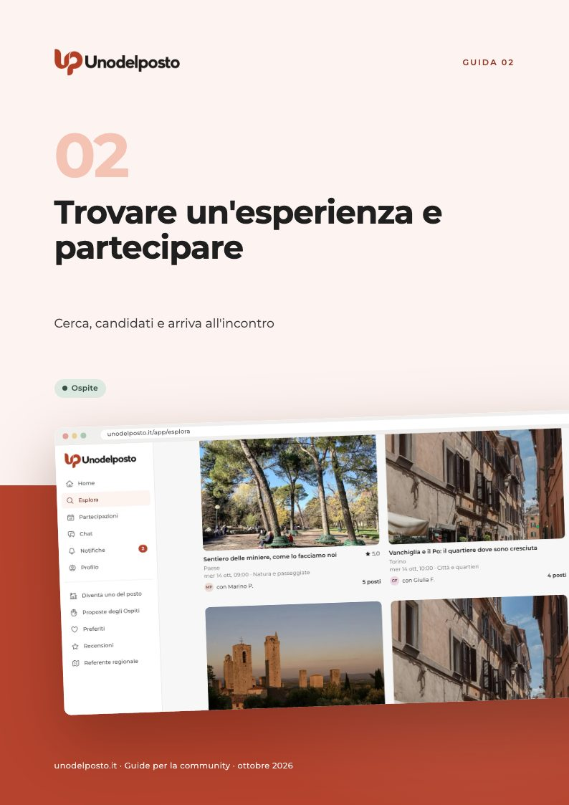
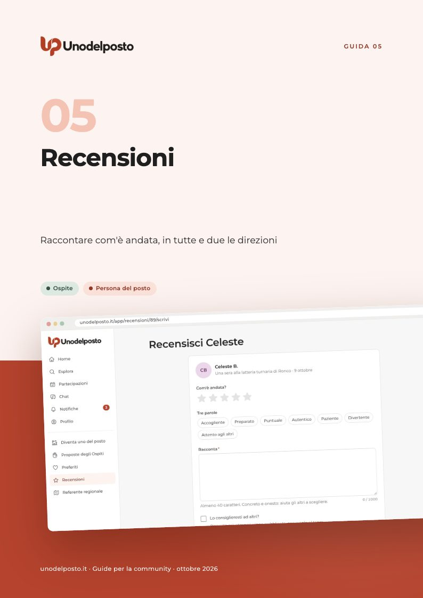
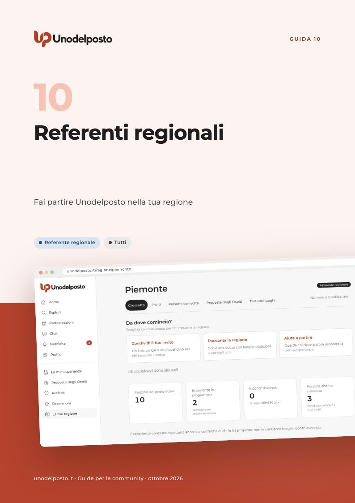

# Guide di Unodelposto

Una guida per ogni funzionalità, in PDF da leggere o stampare. Ogni guida spiega come funziona la funzione per ciascun tipo di utente: Ospite, persona del posto, Ente, referente regionale.

<table>
<tr>
<td width="33%" valign="top"> <b><a href="01-primi-passi/">01 · Primi passi</a></b> Tutti <a href="01-primi-passi/guida-primi-passi.pdf">PDF, 12 pagine</a></td>
<td width="33%" valign="top"> <b><a href="02-trovare-e-partecipare/">02 · Trovare un'esperienza e partecipare</a></b> Ospite <a href="02-trovare-e-partecipare/guida-trovare-e-partecipare.pdf">PDF, 13 pagine</a></td>
<td width="33%" valign="top"> <b><a href="03-proporre-esperienze/">03 · Proporre un'esperienza</a></b> Persona del posto · Staff <a href="03-proporre-esperienze/guida-proporre-esperienze.pdf">PDF, 15 pagine</a></td>
</tr>
<tr>
<td width="33%" valign="top"> <b><a href="04-chat-di-gruppo/">04 · Chat di gruppo</a></b> Ospite · Persona del posto <a href="04-chat-di-gruppo/guida-chat-di-gruppo.pdf">PDF, 11 pagine</a></td>
<td width="33%" valign="top"> <b><a href="05-recensioni/">05 · Recensioni</a></b> Ospite · Persona del posto <a href="05-recensioni/guida-recensioni.pdf">PDF, 9 pagine</a></td>
<td width="33%" valign="top"> <b><a href="06-proposte-degli-ospiti/">06 · Proposte degli Ospiti</a></b> Ospite · Persona del posto · Referente regionale · Staff <a href="06-proposte-degli-ospiti/guida-proposte-degli-ospiti.pdf">PDF, 12 pagine</a></td>
</tr>
<tr>
<td width="33%" valign="top"> <b><a href="07-sicurezza-e-fiducia/">07 · Sicurezza e fiducia</a></b> Tutti · Ospite · Persona del posto · Staff <a href="07-sicurezza-e-fiducia/guida-sicurezza-e-fiducia.pdf">PDF, 12 pagine</a></td>
<td width="33%" valign="top"> <b><a href="08-enti-e-progetti/">08 · Enti e Progetti</a></b> Ente · Persona del posto · Ospite · Staff <a href="08-enti-e-progetti/guida-enti-e-progetti.pdf">PDF, 14 pagine</a></td>
<td width="33%" valign="top"> <b><a href="09-rete-verifiche-profili-affidati/">09 · Rete, verifiche e profili affidati</a></b> Ente · Persona del posto · Ospite <a href="09-rete-verifiche-profili-affidati/guida-rete-verifiche-profili-affidati.pdf">PDF, 12 pagine</a></td>
</tr>
<tr>
<td width="33%" valign="top"> <b><a href="10-referenti-regionali/">10 · Referenti regionali</a></b> Referente regionale · Tutti <a href="10-referenti-regionali/guida-referenti-regionali.pdf">PDF, 13 pagine</a></td>
</tr>
</table>

## Elenco

| # | Guida | Di cosa parla | Per chi |
|---|---|---|---|
| 01 | [Primi passi](01-primi-passi/) | Come iscriversi, accedere con un codice via email, completare il profilo, ricevere le notifiche, installare l'app e regolare le impostazioni. | Tutti |
| 02 | [Trovare un'esperienza e partecipare](02-trovare-e-partecipare/) | Come cercare un'esperienza, leggere la scheda, candidarti, seguire la candidatura in Partecipazioni e arrivare preparato all'incontro. | Ospite |
| 03 | [Proporre un'esperienza](03-proporre-esperienze/) | Come si diventa uno del posto, come si crea un'esperienza in sei passi, cosa controlla lo staff e come si gestiscono candidature, chat e incontro. | Persona del posto · Staff |
| 04 | [Chat di gruppo](04-chat-di-gruppo/) | Quando nasce la chat di gruppo, chi c'è dentro, dove trovi il punto d'incontro esatto, come uscire, segnalare un messaggio e gestire cambi e annullamenti. | Ospite · Persona del posto |
| 05 | [Recensioni](05-recensioni/) | Come si scrivono e si leggono le recensioni dopo un incontro: tempi, pubblicazione, risposta, profilo pubblico, segnalazioni e assenze. | Ospite · Persona del posto |
| 06 | [Proposte degli Ospiti](06-proposte-degli-ospiti/) | Come un Ospite scrive una Proposta, come viene controllata, come si candidano le persone del posto del comune e come si arriva all'incontro. | Ospite · Persona del posto · Referente regionale · Staff |
| 07 | [Sicurezza e fiducia](07-sicurezza-e-fiducia/) | Le protezioni di Unodelposto, i consigli prima e durante l'incontro, come segnalare e bloccare, cosa vedono gli altri del tuo profilo e cosa succede dopo una segnalazione. | Tutti · Ospite · Persona del posto · Staff |
| 08 | [Enti e Progetti](08-enti-e-progetti/) | Come un Ente apre un Progetto a tempo, come le persone del posto propongono esperienze per il Progetto e come i partecipanti entrano con il codice. | Ente · Persona del posto · Ospite · Staff |
| 09 | [Rete, verifiche e profili affidati](09-rete-verifiche-profili-affidati/) | La Rete dell'Ente, le verifiche d'identità e i profili affidati: cosa fa l'Ente, come chiede di entrare la persona del posto e come si fa verificare un Ospite. | Ente · Persona del posto · Ospite |
| 10 | [Referenti regionali](10-referenti-regionali/) | Cosa fanno referenti e collaboratori regionali, come ci si candida e come si usa l'area della regione: inviti, persone coinvolte, Proposte degli Ospiti e testi dei luoghi. | Referente regionale · Tutti |

Gli screenshot mostrano dati dimostrativi: nomi, luoghi ed Enti sono di fantasia.

[← Torna al progetto](../README.md)
